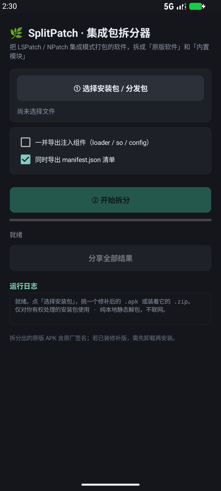

# 🌿 SplitPatch · Embedded-Mode APK Splitter


> 🌐 **English** · [简体中文](README.md)

> Split an APK produced by **LSPatch / NPatch in embedded mode (`--embed`)**
> back into two independent, ready-to-use parts: the **original app** and its
> **embedded modules**.

The same splitting engine ships in two forms: a **Windows desktop GUI** and a
**native Android app**. Everything runs locally; no network access, no patching,
and no bypass of any app's licensing or signature checks.

---

## What problem does it solve?

LSPatch / NPatch's embedded mode bundles Xposed modules (for example, the
BiliRoaming module) together with a loader into the target APK, producing a
standalone patched package that needs no manager app. Later on, switching
modules, going back to the stock app, or simply extracting a module on its own
becomes awkward. SplitPatch puts them back apart:

```
Patched APK / distribution ZIP
        │
        ├── original/xxx_original.apk   ← raw bytes stored by the patcher, with the vendor signature
        ├── modules/xxx.apk             ← complete, standalone module package
        ├── manifest.json               ← inventory: source, size, SHA-256, CRC result
        └── report.html                 ← visual report (Windows build only)
```

**The key point is byte-for-byte restoration.** The patcher stored the entire
pre-patch APK as `origin.apk`, so what comes out is *not* a reconstructed
approximation — it is identical to the official original, down to every byte,
and still carries its original signature.

---

## Quick start

### Windows

1. Install Python 3.10+ (the GUI needs `tkinter`).
2. Double-click **`SplitPatch/启动拆分工具.bat`** — it picks an interpreter with
   tkinter automatically.
3. Choose a file → **分析结构** (Analyze) → **开始拆分** (Split).

You can also drag an `.apk` / `.zip` straight onto the `.bat` to prefill the
path. Command-line usage:

```bash
python SplitPatch/splitpatch.py "embedded.zip" -o ./out
python SplitPatch/splitpatch.py patched.apk --export-injected   # also export loader / so / config
python SplitPatch/splitpatch.py patched.apk --dry-run            # detect only, write nothing
```

### Android

1. Copy **`Android/out/SplitPatch-Android.apk`** to the phone and install it
   (self-signed, so allow "Install unknown apps").
2. Open the app → **选择安装包** (Choose package) → pick an `.apk` or a
   `.zip` / `.apks` / `.xapk` containing one → **开始拆分** (Split).
3. Results land in **`Download/SplitPatch/`**. Each result card can be shared
   individually, or use **分享全部结果** (Share all).

Requires Android 8.0+ (minSdk 26) and requests **zero permissions** — no
permission dialog at install time.



---

## Supported inputs

| Input | Handling |
|---|---|
| Patched `.apk` | Parsed directly |
| `.zip` / `.apks` / `.xapk` bundle | APKs inside are extracted and probed until an embedded layout is found |
| Extension-less file (Android SAF) | Detected by content and still treated as an APK |

Recognized injection layout (directory names are **not** hardcoded, since some
forks rename them to evade detection):

```
assets/<lspatch|npatch|custom>/
├── origin.apk        Original APK, embedded whole as STORED — this is what restoration uses
├── config.json       PatchConfig: useManager / sigBypassLevel / originalSignature ...
├── modules/*.apk     Embedded Xposed modules
├── loader.dex        Loader (NPatch may call it loader.bin / metaloader.dex)
└── so/<abi>/lib*patch.so
```

`config.useManager = false` plus a `modules/` directory → embedded mode.
If `origin.apk` is **absent** (for example, local mode), modules are still
extracted and the report explicitly states that the original cannot be restored.

---

## How it works: why plain `zipfile` fails

LSPatch uses apkzlib's **NestedZip** trick: the original APK is aligned and
embedded whole as a STORED (uncompressed) entry, *and the entries inside that
APK are also registered in the outer central directory*. The outer ZIP's entries
therefore overlap each other in the data area:

```
assets/lspatch/origin.apk     offset=848     csize=241561212
assets/dexopt/baseline.prof   offset=4096    csize=46201     ← falls inside the block above
```

CPython 3.13+ detects that overlap and raises
`BadZipFile: Overlapped entries (possible zip bomb)`, so a naive implementation
cannot read the original at all.

Both engines parse the ZIP themselves:

1. Locate the **EOCD** at the end of the file and read the central directory
   offset and size.
2. Walk the central directory, recording each entry's
   `compress_type / compress_size / CRC32 / header_offset` (ZIP64-aware).
3. Jump to the **local file header** and use *its own* `name_len / extra_len`
   to locate the data — apkzlib puts alignment padding in the local extra
   field, whose length differs from the central-directory copy; using the wrong
   one yields garbage.
4. Copy STORED entries verbatim; inflate DEFLATED entries with raw inflate
   (no zlib header).
5. Compute **CRC32 and SHA-256** chunk by chunk, compare against the central
   directory CRC, and warn on mismatch.

Large files are streamed throughout; the package is never loaded into memory
as a whole.

---

## Project layout

```
SplitPatch/                      Windows build
├── splitpatch.py                Engine + CLI (standard library only, zero dependencies)
├── splitpatch_gui.py            tkinter dark-theme GUI
└── 启动拆分工具.bat              Picks a Python with tkinter automatically

Android/                         Native Android build
├── app/
│   ├── AndroidManifest.xml
│   ├── java/top/nkbe/splitpatch/
│   │   ├── SplitCore.java       Pure Java core (no Android APIs; runs on a desktop JVM)
│   │   └── MainActivity.java    UI, SAF file picking, MediaStore export
│   └── res/                     "Chinatsu" icon: 5 mipmap densities + adaptive icon
├── build_apk.py                 One-step build (no Gradle, no network)
└── out/SplitPatch-Android.apk   Installable artifact
```

`SplitCore.java` has no dependency on Android APIs, so you can verify it on a
desktop:

```bash
java -cp build/classes top.nkbe.splitpatch.SplitCore <input> <outdir> --injected
```

---

## Building the Android app from source

Requirements: JDK 17+, Android SDK (**build-tools 35.0.0** +
**platforms/android-35**), with `ANDROID_HOME` (or `ANDROID_SDK_ROOT`) set.
No Gradle and no network access needed.

```bash
python Android/build_apk.py
```

The script wires up the full toolchain:
`aapt2 compile → aapt2 link → javac → d8 → merge classes.dex → zipalign → keytool self-sign → apksigner sign/verify`

The first run generates a self-signed certificate at
`Android/keystore/splitpatch.jks`. **That keystore is not committed** — it stays
on your machine so rebuilt APKs can be installed as updates. Anyone cloning the
repository gets their own signing key and therefore cannot overwrite the copy
already installed on your phone.

---

## Caveats

- The restored original APK keeps its **vendor signature** and needs no
  re-signing. If a patched build with a different signature is already
  installed, uninstall it before installing the original.
- For 200 MB+ packages on a phone, allow roughly **3× the file size** in free
  space and keep the app in the foreground while it works.
- This tool only performs static extraction and restoration. It **does not
  modify or bypass any app's licensing or signature verification**. Use it only
  on packages you are entitled to handle.

---

## Version

`v1.0.0` · First release · Windows GUI + native Android app · engine v1.0.0

## License

[MIT](LICENSE) · Copyright © 2026 zy2755
