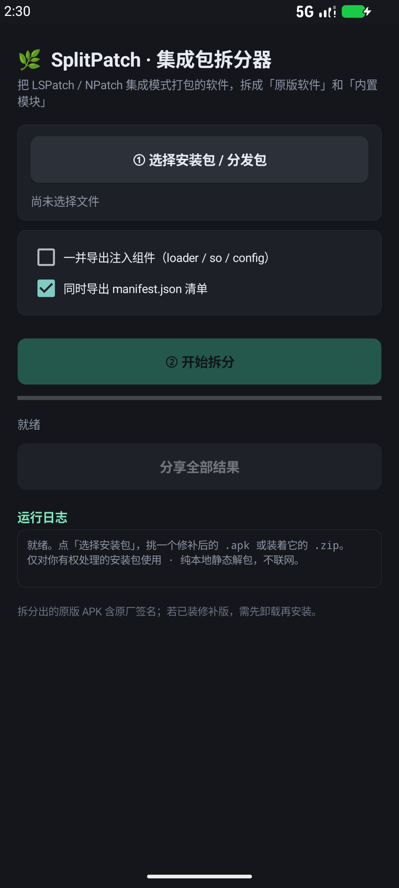

# 🌿 SplitPatch · 集成包拆分器


> 把 **LSPatch / NPatch「集成模式（`--embed`）」**打包出来的 APK，拆成
> **原版软件** 和 **内置模块** 两堆互不相干、可以直接使用的文件。

同一个拆分引擎，提供 **Windows 图形界面工具** 和 **原生 Android 应用** 两种形态。
纯本地静态解包，不联网、不修改、不绕过任何软件的授权或签名校验逻辑。

---

## 它解决什么问题

NPatch / LSPatch 的集成模式会把 Xposed 模块（例如「哔哩哔哩漫游模块」）和加载器一起
塞进目标 APK，生成一个可以独立分发、不需要管理器的修补包。时间久了想换模块、想回到原版，
或者只是想把模块单独拿出来用，就很麻烦 —— 这个工具就是把它们重新分开：

```
修补后的 APK / 分发包 ZIP
        │
        ├── 原版软件/xxx_原版.apk      ← 修补器内嵌的原始字节，含原厂签名
        ├── 内置模块/xxx.apk           ← 完整的独立模块包
        ├── manifest.json             ← 清单：来源、大小、SHA-256、CRC 结果
        └── 拆分报告.html             ← Windows 版额外生成的可视化报告
```

**关键点是"字节级还原"**：修补器把打包前的原始 APK 整个塞进了 `origin.apk`，
所以拆出来的不是"猜着重打包"的近似品，而是和官方原包逐字节一致、带原厂签名的文件。

---

## 快速开始

### Windows

1. 装 Python 3.10+（图形界面需要 `tkinter`）
2. 双击 **`SplitPatch/启动拆分工具.bat`** —— 它会自己挑一个带 tkinter 的解释器
3. 选文件 → 点「分析结构」→ 点「开始拆分」

也可以把 `.apk` / `.zip` 直接拖到 bat 上预填路径。想用命令行的：

```bash
python SplitPatch/splitpatch.py "内置模块.zip" -o ./out
python SplitPatch/splitpatch.py patched.apk --export-injected   # 连 loader/so/config 一起导出
python SplitPatch/splitpatch.py patched.apk --dry-run            # 只检测结构，不写文件
```

### Android

1. 把 **`Android/out/SplitPatch-Android.apk`** 传到手机，点开安装（自签名，需允许"未知来源"）
2. 打开 App →「选择安装包」→ 挑 `.apk` 或装着它的 `.zip/.apks/.xapk` →「开始拆分」
3. 结果保存在 **`下载/SplitPatch/`**，每张结果卡片都能单独分享，也能「分享全部结果」

Android 版要求 Android 8.0+（minSdk 26），**零权限**，安装时不弹任何权限框。



---

## 支持的输入

| 输入 | 处理方式 |
|---|---|
| 修补后的 `.apk` | 直接解析 |
| `.zip` / `.apks` / `.xapk` 分发包 | 自动展开里面的 APK，逐个检测直到命中注入结构 |
| 没有扩展名的 SAF 文件 | Android 端按内容兜底，仍当 APK 解析 |

识别的注入布局（不写死目录名，有些分支会改名规避检测）：

```
assets/<lspatch|npatch|自定义>/
├── origin.apk        原始 APK，STORED 整块嵌入 —— 还原原版就靠它
├── config.json       PatchConfig：useManager / sigBypassLevel / originalSignature ...
├── modules/*.apk     内嵌的 Xposed 模块
├── loader.dex       加载器（NPatch 里可能叫 loader.bin / metaloader.dex）
└── so/<abi>/lib*patch.so
```

`config.useManager = false` 且有 `modules/` → 判定为集成模式。
如果包里**没有** `origin.apk`（例如本地模式），工具仍会提取模块，并在报告里明确说明无法还原原版。

---

## 工作原理：为什么不能用普通的 zipfile

LSPatch 用 apkzlib 的 **NestedZip** 技术，把原始 APK 以 STORED（不压缩）方式整块对齐嵌入修补包，
并且把**原包内部的条目也登记到外层中央目录**。于是外层 ZIP 的条目在数据区上互相重叠：

```
assets/lspatch/origin.apk     offset=848     csize=241561212
assets/dexopt/baseline.prof   offset=4096    csize=46201     ← 落在上一块内部
```

CPython 3.13+ 的 `zipfile` 会检测这种重叠并抛
`BadZipFile: Overlapped entries (possible zip bomb)`，普通写法根本读不出原版。

两个平台的引擎都自己解析 ZIP：

1. 从文件尾部找 **EOCD**，读出中央目录偏移与大小
2. 遍历中央目录，记录每个条目的 `compress_type / compress_size / CRC32 / header_offset`，兼容 ZIP64
3. 跳到 **local file header**，用 *local header 自己的* `name_len / extra_len` 定位数据区
   （apkzlib 会在 local extra 里塞对齐填充，与中央目录的 extra 长度不同，用错就读到脏数据）
4. STORED 直接原样搬运；DEFLATED 用 raw inflate 解压
5. 逐块算 **CRC32 与 SHA-256**，与中央目录的 CRC 核对，不一致就报警

大文件全程流式读写，不整包进内存。

---

## 目录结构

```
SplitPatch/                    Windows 版
├── splitpatch.py              拆分引擎 + CLI（纯标准库，零依赖）
├── splitpatch_gui.py          tkinter 深色界面
└── 启动拆分工具.bat           自动挑选带 tkinter 的 Python

Android/                       原生 Android 版
├── app/
│   ├── AndroidManifest.xml
│   ├── java/top/nkbe/splitpatch/
│   │   ├── SplitCore.java     纯 Java 核心（零 Android API，可在桌面 JVM 直接跑）
│   │   └── MainActivity.java  界面、SAF 选文件、MediaStore 导出
│   └── res/                   「千夏」图标：5 档 mipmap + 自适应图标
├── build_apk.py               一键构建（不用 Gradle、不联网）
└── out/SplitPatch-Android.apk 可直接安装的成品
```

`SplitCore.java` 不依赖任何 Android API，因此可以这样在电脑上直接验证：

```bash
java -cp build/classes top.nkbe.splitpatch.SplitCore <input> <outdir> --injected
```

---

## 从源码构建 Android 版

需要：JDK 17+、Android SDK（**build-tools 35.0.0** + **platforms/android-35**），
并设置好 `ANDROID_HOME`（或 `ANDROID_SDK_ROOT`）。不需要 Gradle，也不需要联网。

```bash
python Android/build_apk.py
```

脚本串起完整链路：
`aapt2 compile → aapt2 link → javac → d8 → 合入 classes.dex → zipalign → keytool 自签 → apksigner sign/verify`

第一次运行会在 `Android/keystore/splitpatch.jks` 生成自签证书。
**这个 keystore 不入库**：它只留在你本机，用来保证以后重新构建的 APK 能覆盖安装；
从仓库 clone 的人会生成自己的签名，无法覆盖你手机上已装的版本。

---

## 注意事项

- 还原出的原版 APK 含**原厂签名**，不用重签；但如果手机上已经装了签名不同的修补版，
  需要先卸载再安装原版。
- 200 MB+ 的包在手机上处理时，大约需要 **3 倍文件大小**的空闲空间，请让 App 保持在前台。
- 工具只做静态解包与还原，**不修改、不绕过任何软件的授权或签名校验逻辑**。
  请只对你有权处理的安装包使用。

---

## 版本

`v1.0.0` · 首次发布 · Windows GUI + 原生 Android App · 引擎 v1.0.0
